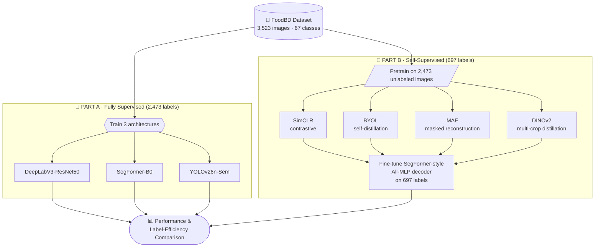

<div align="center">

# 🍛 FoodBD Semantic Segmentation

### How Much Segmentation Accuracy Survives When 72% of the Labels Disappear?

**DeepLabV3 · SegFormer · YOLO · SimCLR · BYOL · MAE · DINOv2**


*A comparative study of **semantic segmentation on Bangladeshi food images**, pitting full supervision against label-efficient self-supervised pretraining.*

</div>

---

## ⚡ TL;DR

> 🏆 **DeepLabV3-ResNet50** is the accuracy champion: **0.5208 mIoU** with full labels.
> 🧠 **DINOv2** is the best self-supervised method: **0.4359 mIoU** with only **697 labeled images**.
> 🏷️ It recovers **90.8%** of SegFormer-B0's supervised mIoU using just **28.2%** of the labels (**~3.55× fewer**).

| 🎯 Task | 🖼️ Data | 🔬 Part A | 🧠 Part B |
| :---: | :---: | :---: | :---: |
| Semantic segmentation | 3,523 images · 67 classes | 3 supervised baselines | 4 SSL methods |

---

## 🧭 Table of Contents

- [Project Overview](#-project-overview)
- [Dataset](#%EF%B8%8F-dataset)
- [Part A: Supervised Baselines](#-part-a--fully-supervised-segmentation)
- [Part B: Self-Supervised Learning](#-part-b--self-supervised-learning)
- [Key Findings](#-key-findings)
- [Analysis & Evaluation](#-analysis--evaluation)
- [The Long-Tail Problem](#%EF%B8%8F-the-long-tail-problem)
- [Tech Stack](#%EF%B8%8F-tech-stack)
- [Getting Started](#-getting-started)
- [Conclusion](#-conclusion)

---

## 🗺️ Project Overview



---

## 🖼️ Dataset

**[FoodBD: A Polygon-Annotated Meal Image Dataset of Bangladesh](https://data.mendeley.com/datasets/xh3ghf3jbg/2)** (Mendeley Data)

| Property | Value |
| :-- | :-- |
| 📦 Total images | **3,523** |
| 🍽️ Classes | **67** foreground food classes + background |
| ✏️ Annotation | Polygon-based semantic segmentation |
| 📐 Resolution | 1024×1024 original → **512×512** for training |
| ✂️ Official split | **2,473** train · **697** val · **353** test |
| ⚖️ Challenge | Significant class imbalance → fine-grained segmentation is hard |

---

## 🔬 Part A · Fully Supervised Segmentation

Three architectures trained on the full **2,473-image** labeled training set:

| Model | mIoU | Pixel Acc. | Params |
| :-- | --: | --: | --: |
| 🏆 **DeepLabV3-ResNet50** | **0.5208** | 0.9410 | 42.0M |
| SegFormer-B0 | 0.4800 | 0.9344 | 3.7M |
| YOLOv26n-Sem | 0.2916 | 0.9266 | 1.6M |

```text
mIoU
DeepLabV3-ResNet50  ████████████████████████████  0.5208   42.0M params
SegFormer-B0        ██████████████████████████    0.4800    3.7M params
YOLOv26n-Sem        ████████████████              0.2916    1.6M params
```

<details>
<summary><b>🤔 Why SegFormer-B0 as the Part B decoder?</b></summary>

<br/>

DeepLabV3 wins on raw accuracy, but **SegFormer-B0's All-MLP head is portable**: it can be reused across different SSL encoders. That makes it a fair, consistent testbed for comparing pretraining methods, and its **0.4800 mIoU** became the fully supervised reference for label-efficiency calculations. Note that SegFormer-B0 reaches that score with roughly **11× fewer parameters** than DeepLabV3.

</details>

---

## 🧠 Part B · Self-Supervised Learning

> **How much of the fully supervised performance can be recovered when only a fraction of the labels is available?**

Four SSL families were pretrained on the **2,473 unlabeled training images**, then fine-tuned with only **697 labels (28.2% of Part A's label count)**.

| Method | Family | Idea |
| :-- | :-- | :-- |
| 🔴 **SimCLR** | Contrastive | Pull augmented views together, push others apart |
| 🔵 **BYOL** | Self-distillation | Online network predicts a slow-moving target |
| 🟠 **MAE** | Masked reconstruction | Hide patches, reconstruct the pixels |
| 🟣 **DINOv2** | Multi-crop self-distillation | Match global and local crops across student/teacher |

### 📊 SSL Results

| Rank | Method | mIoU | Pixel Acc. | Params |
| :-: | :-- | --: | --: | --: |
| 🥇 | **DINOv2** | **0.4359** | **0.9431** | 22.7M |
| 🥈 | BYOL | 0.3859 | 0.9337 | 24.8M |
| 🥉 | MAE | 0.3442 | 0.9247 | 86.9M |
| 4 | SimCLR | 0.2248 | 0.8661 | 39.1M |

```text
mIoU
DINOv2   ███████████████████████  0.4359  🥇
BYOL     ████████████████████     0.3859
MAE      ██████████████████       0.3442
SimCLR   ████████████             0.2248
```

DINOv2 also posted the **highest pixel accuracy (0.9431) of every model in the study**, supervised baselines included.

---

## 📊 Key Findings

| | Finding |
| :-: | :-- |
| 🏆 | **Best overall accuracy:** DeepLabV3-ResNet50 at **0.5208 mIoU** |
| 🧠 | **Best SSL method:** DINOv2 at **0.4359 mIoU** with only **697 labels** |
| 🏷️ | **Label efficiency:** **90.8%** of SegFormer-B0's mIoU with **~3.55× fewer** labeled images |
| 📈 | **SSL ranking:** **DINOv2 > BYOL > MAE > SimCLR** |
| 🪶 | **Not about size:** MAE (86.9M) trailed DINOv2 (22.7M) by a wide margin |

**Takeaway:** self-distillation (DINOv2, BYOL) and masked reconstruction (MAE) transferred better to **dense** prediction than contrastive learning (SimCLR) in this experiment.

---

## 🔎 Analysis & Evaluation

- 📈 Training & validation curves
- 📏 mIoU and pixel-level metrics
- 🎯 Per-class IoU analysis
- 🔀 Confusion / error analysis
- 🖼️ Qualitative segmentation comparisons
- 🏷️ Label-efficiency analysis
- ❄️ Frozen vs. fine-tuned encoder comparison
- ⚔️ SSL method comparison

<!-- 💡 Tip: add your qualitative comparison figures here!
<p align="center">
  
</p>
-->

---

## ⚖️ The Long-Tail Problem

The biggest obstacle across **all** models was **severe class imbalance**. Rare classes such as *achar, apple, cabbage, chomchom,* and *egg* frequently collapsed to very low IoU.

The pattern appeared regardless of the pretraining method, which suggests the limiting factor is largely the **dataset's long-tail distribution**, not any particular model choice. Improving rare-class performance (class-balanced losses, resampling, more data for tail classes) looks like the most promising next step.

---

## 🛠️ Tech Stack

| Area | Tools |
| :-- | :-- |
| 🧠 **Deep learning** | `Python` · `PyTorch` · `timm` · `torchvision` · `Ultralytics` · `Hugging Face Transformers` |
| 📊 **Data & analysis** | `NumPy` · `Pandas` · `Scikit-learn` |
| 🎨 **Visualization** | `Matplotlib` · `Jupyter Notebook` |

---

## 🚀 Getting Started

```bash
# 1. Clone the repository
git clone https://github.com/<your-username>/<your-repo-name>.git
cd <your-repo-name>

# 2. Install dependencies
pip install torch torchvision timm transformers ultralytics \
            numpy pandas scikit-learn matplotlib jupyter

# 3. Download FoodBD from Mendeley Data and place it in your data folder
#    https://data.mendeley.com/datasets/xh3ghf3jbg/2

# 4. Launch the notebooks
jupyter notebook
```

> 📝 Run Part A first to reproduce the supervised baselines, then Part B for the SSL pretraining and fine-tuning experiments.

---

## 💡 Conclusion

<div align="center">

### From full supervision to label-efficient segmentation:<br/>how much performance can we retain when labels are limited?

## ✅ A substantial amount, especially with DINOv2.

Full supervision still wins on mIoU, but **DINOv2 recovered 90.8% of the SegFormer-B0 baseline using only 28.2% of the labels**, making it the strongest label-efficient approach tested.

**Fewer labels. Competitive segmentation.**

⭐ **If you found this useful, consider starring the repo!** ⭐

</div>